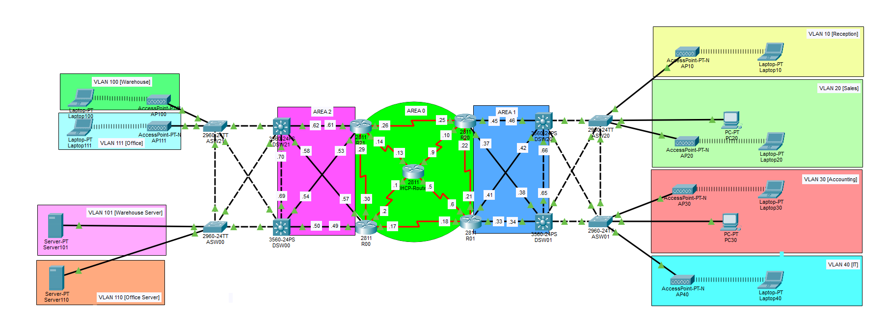

# Mid-Size Organization Redundancy
Pretty basic simulation of a mid-size organization with dedicated VLANs for a handful of departments, and a detached warehouse facility.

### Side note:
> In a real-world deployment, it would make significantly more sense to use a WLC to allow for centralized control to manage the WLANs & Access Points. Said deployment should also consider a centralized authentication server (like RADIUS) for SSH access.

## Key Configuration Points:
### Routers:
- Multi-Area OSPF
- SSH Remote Access (local account)
- Secure Console Access
- Centralized DHCP Server

### Layer 3 Switches:
- Multi-Area OSPF
- SSH Remote Access (local account)
- Secure Console Access
- HSRP with Inter-VLAN Routing
- Rapid PVSTP
- Static Trunking

### Layer 2 Switches:
- Secure Console Access
- Rapid PVSTP
- Static Trunking
- Multiple VLANs
- BPDU Guard & Port Security

### Access Points:
- Guest WLAN
- WPA2 Secured WLANs
- VLAN-Specific WLANs

## Topology Preview:
