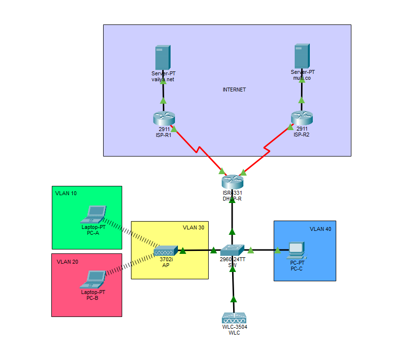

# WLC-Controlled WLAN
Extremely bare-bones topology showcasing a multiple-vlan WLC-managed WLAN.

### Side note:
> In a real-world deployment, the Gateway DHCP-R router should be using BGP on the internet-facing links. Said deployment would also **never** use unsecured SSH remote access, as it poses an extreme severity security vulnerability.

## Key Configuration Points:
### Routers:
- OSPF
- Inter-VLAN Routing
- Static-Clock Serial Link
- Central DHCP Server
- SSH Remote Access (local account)

### L2 Switch:
- Unsecured SSH Remote Access
- Secure Console Access
- Static Trunking
- Multiple VLANs

## Topology Preview
